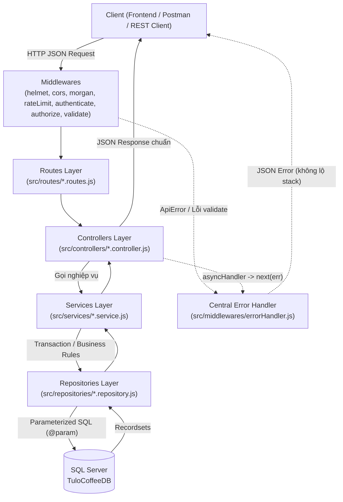
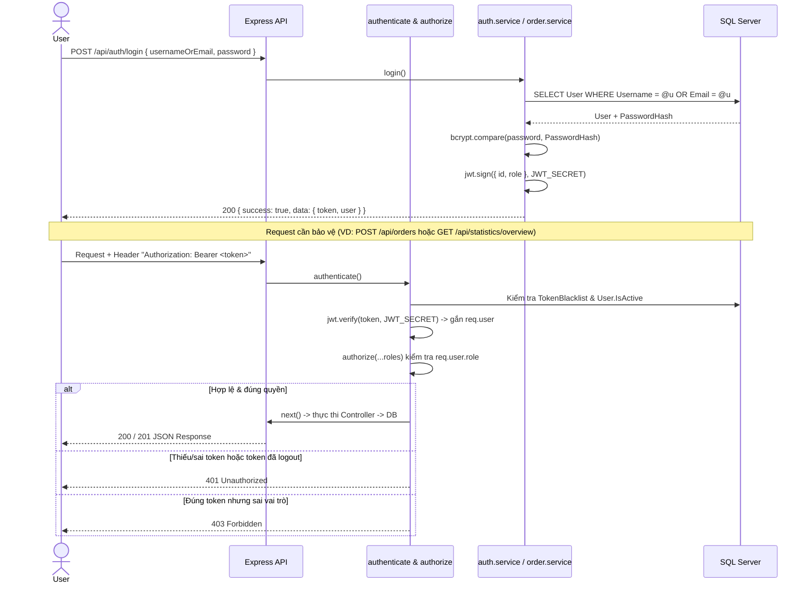

# Kiến trúc Hệ thống Backend – Tulo Coffee

## 1. Kiến trúc phân tầng (Layered Architecture)

Backend được thiết kế theo mô hình **4 tầng tách biệt rõ ràng**, mỗi tầng đảm nhận một trách nhiệm duy nhất:

## 2. Vai trò từng tầng
- **Routes (`src/routes/`)**: Định nghĩa đường dẫn RESTful, gắn rate limiter, `authenticate`, `authorize(...roles)` và `validate`.
- **Validators (`src/validators/`)**: Khai báo luật kiểm tra dữ liệu đầu vào bằng `express-validator` trước khi vào Controller.
- **Controllers (`src/controllers/`)**: Nhận `req`, gọi Service tương ứng, đóng gói kết quả theo chuẩn `{ success, message, data }`.
- **Services (`src/services/`)**: Chứa toàn bộ logic nghiệp vụ (băm mật khẩu, sinh JWT, kiểm tra trùng lặp, kiểm tra ownership, tự sinh mã món, tính tổng hợp thống kê).
- **Repositories (`src/repositories/`)**: Thực thi câu lệnh SQL qua thư viện `mssql` với **Parameterized Queries** (`@param`) và quản lý **SQL Transaction** (tạo đơn hàng + chi tiết đơn).
- **Middlewares (`src/middlewares/`)**: Xử lý cắt ngang (xác thực JWT, kiểm tra blacklist token, phân quyền RBAC, bắt 404, xử lý lỗi tập trung).

## 3. Luồng xác thực & phân quyền JWT

