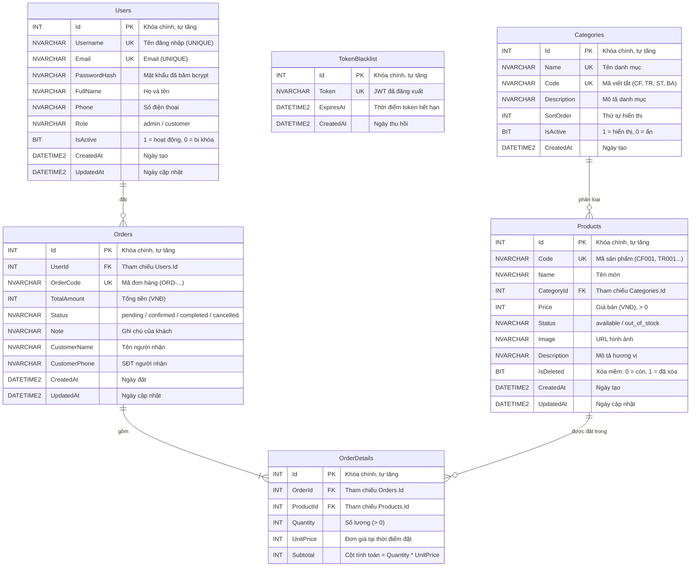

# Sơ đồ Thực thể Kết hợp (ERD) – Tulo Coffee

Hệ thống sử dụng **6 bảng** trong SQL Server (`TuloCoffeeDB`), chuẩn hóa đạt chuẩn **3NF** với đầy đủ khóa chính (`PK`), khóa ngoại (`FK`), ràng buộc toàn vẹn (`UNIQUE`, `CHECK`, `DEFAULT`, `NOT NULL`) và chỉ mục (`INDEX`).

## Giải thích chuẩn hóa 3NF & thiết kế dữ liệu
1. **Tách `Categories` khỏi `Products`**: Nếu thay đổi tên danh mục, chỉ cần sửa 1 dòng trong `Categories`, không bị dư thừa dữ liệu hay bất thường cập nhật.
2. **Tách `OrderDetails` khỏi `Orders`**: Một đơn hàng có nhiều món (quan hệ N-N giữa `Orders` và `Products`), tách thành bảng trung gian `OrderDetails` với `UnitPrice` lưu lại giá bán tại thời điểm đặt hàng để không bị sai lệch doanh thu lịch sử nếu Admin sửa giá món về sau.
3. **Xóa mềm (`IsDeleted`) trên `Products`**: Đảm bảo các đơn hàng cũ đã đặt món đó không bị lỗi khóa ngoại hoặc mất dữ liệu thống kê khi Admin xóa món khỏi thực đơn.
4. **Bảng `TokenBlacklist`**: Lưu trữ JWT đã đăng xuất để vô hiệu hóa phiên ngay lập tức khi người dùng gọi `POST /api/auth/logout`.

