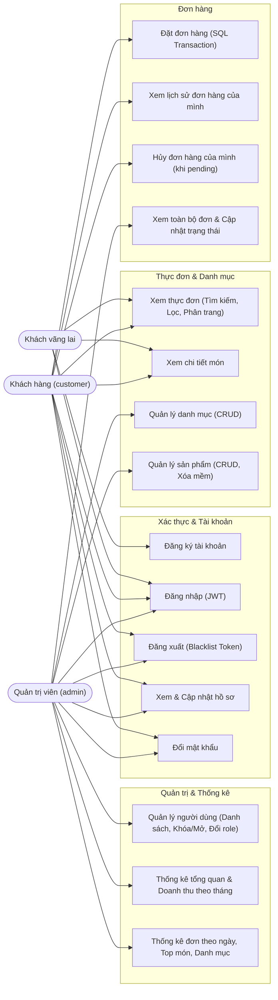

# Biểu đồ & Danh sách Use Case – Tulo Coffee

Hệ thống phân chia thành **2 vai trò chính**:
- **Khách hàng (`customer`)**: Đăng ký, đăng nhập, quản lý hồ sơ, xem thực đơn, đặt hàng, theo dõi và hủy đơn chờ xử lý.
- **Quản trị viên (`admin`)**: Toàn quyền quản lý thực đơn, danh mục, đơn hàng, người dùng và xem báo cáo thống kê.

